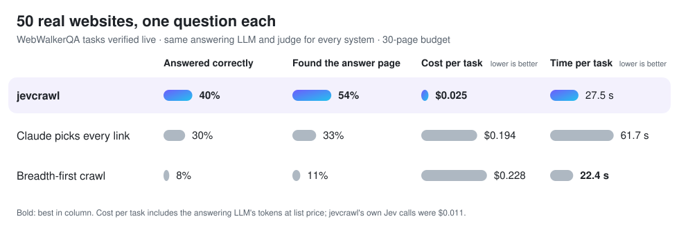
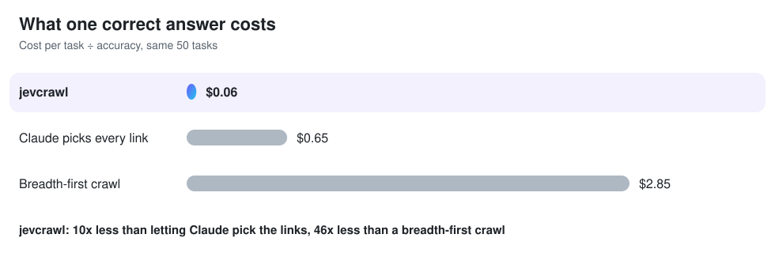
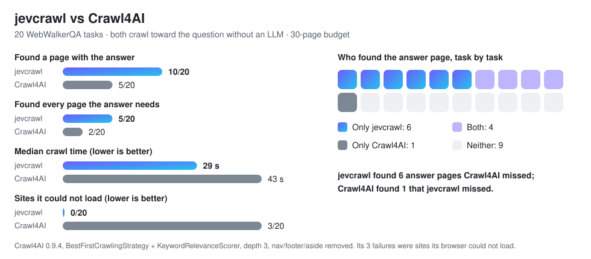

<div align="center">

<picture>
  <source media="(prefers-color-scheme: dark)" srcset="assets/logo-dark.svg">
  
</picture>

### The web crawler for AI agents that finds the answer, not just pages.

A small decision model picks every link and every passage, so your agent's LLM reads
**only what answers its question** at **a few cents per crawl**.

[](https://pypi.org/project/jevcrawl/)
[](https://github.com/RayenMlayeh/jevcrawl/actions/workflows/ci.yml)
[](LICENSE)
[](pyproject.toml)
[](https://modelcontextprotocol.io)
[](#benchmarks)
[](#cost-and-privacy)

[Quick start](#quick-start) · [Benchmarks](#benchmarks) · [Tools](#tools) ·
[How it works](#how-it-works) · [Configuration](#configuration)

</div>

<br>

<p align="center">
  
</p>

<picture>
  <source media="(prefers-color-scheme: dark)" srcset="assets/scoreboard-dark.svg">
  
</picture>

## Why jevcrawl

Agents that browse a site have two bad options. They can **read everything** a crawler fetches,
which buries the answer in navigation and boilerplate and burns tokens. Or they can **let the LLM
pick each link**, which is slow and costs dollars per question. jevcrawl does neither:

- 🎯 **Finds the answer page more often.** 54% of tasks vs 33% when Claude picks the links, and
  2x as often as [Crawl4AI](#jevcrawl-vs-crawl4ai)'s goal-directed crawl.
- 💸 **About 8x cheaper per task, 10x per correct answer.** The crawl decisions cost about a cent.
- ⚡ **2x faster than an LLM-driven crawl.** Four pages at a time, one decision request per page.
- 📜 **Verbatim, with sources.** Every passage is copied from the page with its URL, heading path
  and character offsets. The decision model only scores, so it cannot invent text.
- 🛡️ **Safe against prompt injection by design.** Page text is only ever scored, never followed.
- 🔌 **Works everywhere MCP does:** Claude Code, Claude Desktop, Cursor, or the CLI.

## Quick start

You need a Jev API key from [console.typesafe.ai](https://console.typesafe.ai/) and
[uv](https://docs.astral.sh/uv/).

**Claude Code**

```bash
claude mcp add jevcrawl -e TYPESAFE_API_KEY=<your key> -- uvx jevcrawl
```

**Claude Desktop, Cursor and other MCP clients** (`mcpServers` in the client's config file)

```json
{
  "mcpServers": {
    "jevcrawl": {
      "command": "uvx",
      "args": ["jevcrawl"],
      "env": { "TYPESAFE_API_KEY": "<your key>" }
    }
  }
}
```

Then ask your agent something like *"Use jevcrawl to find which Python version added the walrus
operator, starting from docs.python.org"*. Check the setup with
`uvx jevcrawl doctor`. Agents that load skills
can also use [`skills/jevcrawl/SKILL.md`](skills/jevcrawl/SKILL.md).

**Pages that need JavaScript** (optional). jevcrawl reads plain HTML. To also render pages that
are empty without JavaScript, add the `js` extra and download Chromium once:

```bash
claude mcp add jevcrawl -e TYPESAFE_API_KEY=<your key> -- uvx --from "jevcrawl[js]" jevcrawl
uvx --from "jevcrawl[js]" playwright install chromium
```

(In `mcpServers`, use `"args": ["--from", "jevcrawl[js]", "jevcrawl"]`.) Only pages detected as
JavaScript shells are opened in the browser, at most five per call, and they are listed in
`stats.js_rendered_urls`. Everything else is still fetched as plain HTML.

## Benchmarks

Every system starts on a site's home page with the same 30-page budget and the same question.
What each one collects goes to the **same answering LLM**, and the **same judge** grades the
answer, so the crawler is the only thing that changes.

<picture>
  <source media="(prefers-color-scheme: dark)" srcset="assets/cost-dark.svg">
  
</picture>

### jevcrawl vs Crawl4AI

[Crawl4AI](https://github.com/unclecode/crawl4ai) is one of the most popular open-source crawlers
for LLMs. Its `BestFirstCrawlingStrategy` with a keyword scorer is its way to crawl toward a question
without an LLM, so we compared the two on whether they fetch the page that holds the answer.

<picture>
  <source media="(prefers-color-scheme: dark)" srcset="assets/crawl4ai-dark.svg">
  
</picture>

### Where the numbers come from

| | |
|---|---|
| **Tasks** | [WebWalkerQA](https://huggingface.co/datasets/callanwu/WebWalkerQA) from *WebWalker: Benchmarking LLMs in Web Traversal* (Wu et al., Alibaba Tongyi Lab, [ACL 2025](https://arxiv.org/abs/2501.07572)): questions whose answers sit several clicks deep in real websites (conferences, universities, organizations, games), in English and Chinese. |
| **Task selection** | Each task was re-checked live before the run: the site and answer page still load and still contain the reference answer. Tasks looked at while developing are excluded ([`bench/tasks/seen-ids.txt`](bench/tasks/seen-ids.txt)). |
| **Accuracy run** | 50 tasks, 2026-10-12. Answering model `claude-opus-5-5`, judge `claude-sonnet-5-5`. |
| **Crawl4AI run** | 20 different tasks, 2026-10-13, Crawl4AI 0.9.4. Crawl only, no LLM: did the crawler fetch the gold page? In the accuracy run, whether a system fetched the gold page closely tracked whether it answered correctly. |
| **Baselines** | *Claude picks every link*: Claude reads each page and chooses the next link. *Breadth-first*: every page to depth 2. All systems share jevcrawl's fetcher and remove navigation and footers. |
| **Costs** | Jev cost is billed and exact. LLM costs are token counts at list price. |
| **Caveats** | 50 and 20 tasks are small samples: the cost gap is large and stable, the accuracy gap less so. Crawl4AI drives a real browser; the benchmark ran jevcrawl without JavaScript rendering. |

The benchmark code and how to reproduce every number: [`bench/`](bench/README.md).

## Tools

| Tool | Use it for |
|---|---|
| `crawl(goal, start_url, max_pages=30, max_seconds=120, return_tokens=4000, max_decision_usd=0.05)` | The answer may be several pages deep. Returns the relevant passages. |
| `scrape(url, goal=None)` | One known page. With a goal, only the relevant passages; without one, all content and no Jev call. |
| `map(start_url, goal, limit=50, max_pages=10)` | Ranked URLs only, to decide what to `scrape`. |

<details>
<summary><b>A real result</b> (docs.python.org, "What does the walrus operator := do and which Python version added it?")</summary>

```json
{"blocks": [{"url": "https://docs.python.org/3/whatsnew/3.8.html",
             "heading_path": "What’s New In Python 3.8 > New Features > Assignment expressions",
             "text": "There is new syntax := that assigns values to variables as part of a larger expression. ...",
             "char_start": 307, "char_end": 580, "relevance": 0.97}],
 "uncertain": [],
 "pages": [{"url": "https://docs.python.org/3/", "title": "3.15.0 Documentation", "lang": "en",
            "text_sha256": "b624ce93..."}],
 "stats": {"pages_fetched": 6, "tokens_raw": 80034, "tokens_returned": 1873, "jev_calls": 11,
           "cache_hits": 0, "jev_input_tokens": 164139, "jev_cost_usd": 0.0069,
           "model": "jev-1.13.0", "degraded": false, "degraded_reason": null,
           "needs_js_urls": [], "stopped_because": "answered", "elapsed_seconds": 8.3}}
```

Trimmed to one block and one page. 80,034 tokens of pages became 1,873 tokens of answer, for
$0.0069, in 8.3 seconds.

- `blocks` are the relevant passages, best first; `uncertain` are borderline ones worth reading
  before concluding something is missing.
- `char_start`/`char_end` index into the page text whose sha256 is in `pages`, so a quote can be
  checked later.
- `stopped_because` is `answered`, `frontier_empty`, `max_pages`, `max_seconds`, `budget` or
  `auth_error`.
- Expected failures come back as `{"error": "<code>", "message": "<what to do>"}`; the tools
  never raise into the agent's session.

</details>

The same operations work from the command line (`uv tool install jevcrawl` or
`pip install jevcrawl` puts `jevcrawl` on your path):

```bash
jevcrawl crawl https://docs.python.org/3/ --goal "What does the walrus operator do?" [--json]
jevcrawl scrape https://example.com/help/returns [--goal "..."] [--json]
jevcrawl map https://example.com --goal "..." [--limit 20]
jevcrawl doctor
```

## How it works

<picture>
  <source media="(prefers-color-scheme: dark)" srcset="assets/how-dark.svg">
  
</picture>

- **Jev decides, it does not write.** [Jev](https://typesafe.ai) returns a probability per
  yes/no question, so it cannot produce text. Everything you get back is copied from the page.
- **Page text is data, never instructions.** It travels only in data fields of a question; every
  question sentence is a fixed string written by jevcrawl. An injected "ignore previous
  instructions" can at worst bias a score.
- **Links below the priority floor are kept in reserve**, not dropped, so a crawl never stops
  early while it still has page budget.
- **Failures degrade, they do not hide.** After three failed Jev requests the crawl continues
  breadth-first, returns every block unscored in `uncertain`, and sets `stats.degraded`.
- **Repeats are free.** Jev's answers are cached locally (`~/.jevcrawl/cache`), so the same goal
  on the same pages costs nothing.

## Configuration

| Environment variable | Meaning | Default |
|---|---|---|
| `TYPESAFE_API_KEY` | Jev API key (required) | none |
| `JEVCRAWL_BASE_URL` | Jev-compatible endpoint | `https://api.typesafe.ai` |
| `JEVCRAWL_MODEL` | model id | `jev-1.13.0` (pinned: thresholds are calibrated per version) |
| `JEVCRAWL_CACHE_DIR` | answer cache | `~/.jevcrawl/cache` |
| `JEVCRAWL_RESPECT_ROBOTS` | skip URLs the site's `robots.txt` disallows (`0` turns it off) | `1` |
| `JEVCRAWL_RENDER_JS` | render JavaScript-only pages when the `js` extra is installed (`0` turns it off) | `1` |

Everything else (thresholds, links per page, concurrency) has a measured default in
[`jevcrawl/config.py`](jevcrawl/config.py), and Python callers can pass their own `Config`.

## Cost and privacy

Jev charges for input tokens only, $0.042 per million for `jev-1.13.0`; in the benchmark a crawl
cost $0.011 on average. `max_decision_usd` is a hard limit: a request that could pass it is never
sent, and the crawl stops with `budget`. Every result reports `jev_cost_usd`, and `tokens_raw`
(what a plain crawl would hand your LLM) against `tokens_returned`.

**Page text is sent to TypeSafe** (blocks, link labels and URLs) to be scored. The API key is
read from the environment and never written to disk or logs.

## Crawling responsibly

jevcrawl follows each site's `robots.txt` by default (set `JEVCRAWL_RESPECT_ROBOTS=0` to turn
that off) and does not rate-limit itself beyond fetching four pages at a time. You are
responsible for the sites you crawl, their terms of service and the law that applies to you. It
never logs in and does not try to get past paywalls or CAPTCHAs. Without the `js` extra it does
not run JavaScript (pages that need it are listed in `stats.needs_js_urls`). Every call is
bounded by `max_pages`, `max_seconds`, `max_decision_usd` and `return_tokens`.

## Contributing

```bash
uv sync
uv run ruff check . && uv run ruff format --check . && uv run mypy --strict jevcrawl
uv run pytest                                    # offline: all HTTP is mocked
TYPESAFE_API_KEY=... uv run pytest -m live -s    # one tiny real request, a fraction of a cent
```

Tests never touch the network or spend money; anything that does is marked `live`. The README
charts are drawn by [`assets/build.py`](assets/build.py) from the measured numbers. Issues and
pull requests are welcome; please report security problems as described in
[SECURITY.md](SECURITY.md).

## Acknowledgments

- [WebWalkerQA](https://github.com/Alibaba-NLP/WebAgent) by Alibaba's Tongyi Lab, for a
  benchmark of questions that really need crawling.
- [Crawl4AI](https://github.com/unclecode/crawl4ai), the baseline we measure against.
- [Model Context Protocol](https://modelcontextprotocol.io), [selectolax](https://github.com/rushter/selectolax)
  and [httpx](https://www.python-httpx.org/).

## License

[Apache-2.0](LICENSE)
